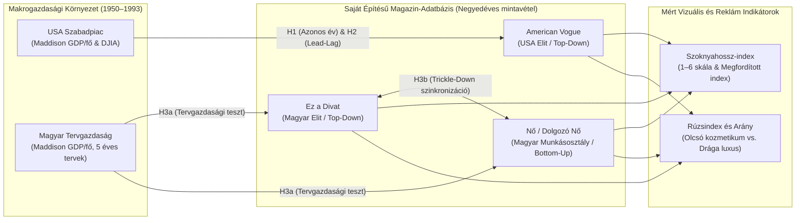

# Kezdeti kutatási terv és feltáró adatelemzés (EDA)

## Hogyan tükrözik a női szoknyahosszak (*Hemline Index*) és a kozmetikai reklámok (*Lipstick Index*) a makrogazdasági ciklusokat, az időbeli késleltetéseket és a politikai-gazdasági rendszerek különbségeit Magyarországon és az Egyesült Államokban (1950–1993)?

**Szerző:** Kiss Eszter Anna  
**Tárgy / Projekt:** Kezdeti kutatási terv, adatbázis-dokumentáció és feltáró adatelemzés (EDA)

> ### Módszertani keret és fontos előzetes megjegyzés
> Ez a dokumentum a teljes kutatás **első, prezentálható munkaváltozata**, amely három fő feladatot valósít meg:
> 1. **Kutatási kérdések, hipotézisek és adatösszegzés:** Pontosítjuk a kutatási narratívát, a három fő hipotézist, valamint áttekintjük a saját kezűleg felépített **3 fő Excel-munkafüzet (`Hypothesis 1–3.xlsx`) és a makrogazdasági háttértábla (`Maddison Project (GDPPC).xlsx`)** tartalmát, adatmennyiségét és változóit.
> 2. **Technikai előkészítés és dokumentált adatbeolvasás:** Bemutatjuk a divatarchívumokból végzett primer adatgyűjtés és kézi kódolás menetét, majd tiszta, reprodukálható módon beolvassuk az adatokat.
> 3. **Kezdeti feltáró adatelemzés (EDA) ábrákkal és táblázatokkal:** Látványos idősoros és összehasonlító grafikonokon vizsgáljuk meg a trendeket, a szezonális mintázatokat, az adatkorlátokat (*limitációkat*), végül kijelöljük a végső projekt lépéseit.
>
> **Oksági határolás:** *Ez a munkafüzet még nem tartalmaz végleges regressziós modellt vagy oksági (kauzális) következtetést. A bemutatott korrelációk és idősoros együttmozgások erős kutatási kiindulópontot adnak, de önmagukban nem bizonyítják, hogy a makrogazdasági kilengések, az infláció vagy a reálgazdasági sokkok közvetlenül okozták a divat- és reklámpiaci változásokat.*

---

## 1. Kutatási narratíva, hipotézisek és a munkafüzetek adatösszegzése

### 1.1. A kutatás története: Tükrözi-e a gardrób és a neszesszer a gazdaság állapotát?

A makrogazdasági hullámzások nem állnak meg a tőzsdeindexek vagy a GDP-jelentések szintjén: láthatatlanul formálják a fogyasztók hétköznapi hangulatát, költségvetési döntéseit és esztétikai választásait. A gazdaságtörténet két legismertebb, mégis ritkán szigorú adatokkal tesztelt „alternatív” (*unconventional*) konjunktúramutatója pont ezt a pszichológiai kapcsolatot ragadja meg:

* **A Szoknyahossz-index (*Hemline Index* — George Taylor, 1926):** Az elmélet szerint gazdasági fellendülés idején a nők rövidebb szoknyákat hordanak (a szegély emelkedik), mert a növekvő jövedelem és az optimista társasági élet kedvez a merészebb divatnak és a sérülékeny, gyakori cserét igénylő harisnyák vásárlásának. Válság idején ezzel szemben a spórolás és a konzervatívabb társadalmi hangulat miatt a szoknyák meghosszabbodnak.
* **A Rúzsindex (*Lipstick Index* — Leonard Lauder, 2001; Hill et al., 2012):** Recesszió idején a háztartások lemondanak a drága luxuscikkekről (dizájner táskák, ékszerek, órák, utazások), de a lemondás okozta feszültséget „megfizethető apróságokkal” – például egy új rúzzsal, krémmel vagy parfümmel – kompenzálják.

**Miért különleges a saját adatbázisunk?**  
A korábbi tanulmányok (pl. van Baardwijk & Franses, 2010; Legka, 2021) gyakran beleestek abba a hibába, hogy egyetlen nyugati magazint hasonlítottak össze egy másik ország GDP-jével, és figyelmen kívül hagyták a társadalmi osztályok vagy a politikai rendszerek közötti különbségeket. Ebben a kutatásban **saját kezűleg építettünk fel egy több mint négy évtizedet átfogó adatbázist**, amely két fronton is újat mutat:
1. **Két gazdasági világot hasonlít össze:** a szabadpiaci kapitalista **Egyesült Államokat** és az államszocialista, tervgazdasági **Magyarországot** a „Nejlonfüggöny” (Péteri, 2004) mögött.
2. **Két társadalmi nézőpontot ütköztet:** a felülről lefelé (*top-down*) ható elit divatlapokat (*American Vogue*, illetve a magyar *Ez a Divat*) és az alulról felfelé (*bottom-up*) szerveződő, hétköznapi dolgozó nőknek szóló életmódmagazint (*Nő / Dolgozó Nő*).



---

### 1.2. A pontosított kutatási kérdések és a 3 fő hipotézis

| Kód | Kutatási kérdés | Hipotézis (Elméleti várakozás) |
| :--- | :--- | :--- |
| **H1 (Egyidejűség)** | Egyidejűleg (ugyanabban a naptári évben) reagálnak-e a szoknyahosszak és a kozmetikai reklámok az amerikai gazdasági növekedésre? | **Nem feltétlenül azonnal:** Bár az alapelmélet azonnali reakciót feltételez (fellendüléskor rövidebb szoknya és kevesebb olcsó kozmetikai reklám), a magazinok gyártási átfutása és a fogyasztói szokások tehetetlensége miatt az azonos évi ($k=0$) kapcsolat gyenge lehet. |
| **H2 (Lead vs. Lag)** | A divat előrejelzi a válságot (*leading indicator*), vagy késve követi a gazdasági ciklusokat (*lagging indicator*)? | **Kettős időzítés:** A **Rúzs-arány előrejelző ($k = -2, -3$ év)** mutatóként működik (a cégek már a közelgő lassulás előtt az olcsóbb kozmetikumok felé tolják a reklámbüdzsét), míg a **Szoknyahossz követő ($k = +2, +3$ év)** mutató (a kifutótól a tömeggyártásig évekre van szükség). |
| **H3 (Rendszer- és osztályhatás)** | Működnek-e ezek a mutatók a szocialista Magyarországon, és hogyan terjedt a divat az elit és a munkásosztály között? | **Tervgazdasági érzéketlenség, de erős kulturális leszivárgás (*Trickle-Down*):** A hazai GDP-ingadozás nem mozgatja a magyar szoknyahosszakat a hiánygazdaság miatt (**H3a**), viszont a nyugati trendek az *Ez a Divat*ból szorosan leszivárognak a *Nő* magazinhoz (**H3b**). |

---

### 1.3. A 3+1 Excel munkafüzet adatösszegzése és változói

A kutatás adatai **három, hipotézisenként felépített elemző munkafüzetben** és **egy makrogazdasági alap-munkafüzetben** helyezkednek el. Minden vizsgált évből **4 negyedéves lapszámot (január, április, július, október)** dolgoztunk fel, lapszámonként átlagosan ~40 darab teljes alakos ruhamodellt és az összes hirdetést lekódolva.

#### 0. Alap-munkafüzet: `Maddison Project (GDPPC).xlsx` (Makrogazdasági háttéradatok)
* **Adatmennyiség és terjedelem:** 7 oldalnyi hosszú távú történelmi GDP/fő (*GDP per capita*, 2011-es nemzetközi dollárban) idősor az Egyesült Államokra (1910–2022) és Magyarországra (1924–2020), a Bolt & van Zanden (2023) adatbázis alapján.
* **Szerepe a kutatásban:** Ez adja a **magyarázó változót** (az éves reál GDP/fő növekedési ütemét), mivel Magyarországon 1991 előtt nem létezett tőzsdeindex (BUX).

#### 1. Munkafüzet: `Hypothesis 1.xlsx` — Egyidejűség vizsgálata (USA, *American Vogue*)
* **Adatösszegzés a munkafüzet elején:**
  * **Időhorizont:** 1932-es *Great Depression* prototípus-teszt + **1957–1992 ($N = 36$ teljes év)** folyamatos idősor.
  * **Feldolgozott adatmennyiség:** $36 \text{ év} \times 4 \text{ negyedév} = 144$ *Vogue* lapszám ($\approx 5\,760$ egyedileg lemért ruha + $>8\,500$ kategorizált luxus- és kozmetikai hirdetés).
  * **Munkalapok:** Negyedéves szoknyahossz-mérések, 12 kategóriás reklámszámláló táblák, éves összesítő tábla, leíró statisztikák és korrelációs/regressziós kimenetek.

| Változó neve | Típus / Szerep | Átlag | Szórás | Min – Max | Rövid tartalmi leírás |
| :--- | :--- | :---: | :---: | :---: | :--- |
| `Delta ln (GDPPC)` | **Magyarázó változó** | $+2{,}11\%$ | $2{,}37\%$ | $-2{,}86\% \dots +6{,}17\%$ | Az USA éves reál GDP/fő növekedési üteme |
| `Vogue Hemline` | Nyers célváltozó | $3{,}55$ | $0{,}57$ | $1{,}77 \dots 4{,}51$ | Nyers szoknyahossz (1 = mini, 6 = földig érő) |
| `Reversed Hemline` | **Függő változó 1** | $2{,}45$ | $0{,}57$ | $1{,}49 \dots 4{,}23$ | Megfordított szoknyahossz ($6 - \text{Hemline}$: nagyobb = rövidebb) |
| `Lipstick Ratio` | **Függő változó 2** | $0{,}410$ | $0{,}128$ | $0{,}170 \dots 0{,}620$ | Az olcsó kozmetikumok aránya az összes luxushirdetésen belül ($41\%$) |

#### 2. Munkafüzet: `Hypothesis 2.xlsx` — Időbeli eltolódások (*Lead–Lag* dinamika, USA)
* **Adatösszegzés a munkafüzet elején:**
  * **Időhorizont és minta:** 1957–1992, időbeli eltolások $k = -3$ évtől (3 éves előrejelzés / *Lead*) $k = +3$ évig (3 éves késleltetés / *Lag*), $n = 33 \dots 36$ megfigyelési párral.
  * **Munkalapok:** Eltolt idősoros mátrixok (`Lead 3`, `Lead 2`, `Lead 1`, `Lag 0`, `Lag 1`, `Lag 2`, `Lag 3`) és keresztkorrelációs összefoglaló tábla.
  * **Változók:** Függő változók a $t+k$ időpontbeli `Reversed Hemline` és `Lipstick Ratio`; magyarázó változó a $t$. évi amerikai GDP/fő növekedés.

#### 3. Munkafüzet: `Hypothesis 3.xlsx` — Rendszer- és osztálykülönbségek (Magyarország: *Ez a Divat* és *Nő*)
* **Adatösszegzés a munkafüzet elején:**
  * **Időhorizont:** *Ez a Divat* (1957–1993), *Nő / Dolgozó Nő* (1952–1992); közös harmonizált metszet: **1957–1992 ($N = 36$ év)**.
  * **Feldolgozott adatmennyiség:** Összesen $>290$ magyar nyelvű negyedéves lapszám az *Arcanum* archívumból ($\approx 9\,500$ egyedileg kódolt ruhamodell és a szocialista sajtóban fellelhető összes kozmetikai/iparcikk hirdetés).
  * **Munkalapok:** *Ez a Divat* negyedéves és éves táblák, *Nő* negyedéves és éves táblák, magyar GDP/fő növekedési tábla, valamint a két tesztcsoport (Test 1: magyar GDP-érzékenység; Test 2: *Ez a Divat* vs. *Nő* osztályszinkronizáció) eredményei.

| Változó neve | Típus / Szerep | Átlag / Bázis | Min – Max | Rövid tartalmi leírás |
| :--- | :--- | :---: | :---: | :--- |
| `Delta ln (GDPPC_HU)` | **Magyarázó változó** | $+2{,}48\%$ | $-9{,}10\% \dots +6{,}80\%$ | Magyar éves reál GDP/fő növekedés (1990–92 között súlyos visszaesés) |
| `Ez a Divat Rev. Hemline` | **Függő / Elit változó** | $2{,}67$ | $1{,}86 \dots 4{,}05$ | Magyar elit divatlap megfordított szoknyahossza (1969-ben 4,05-ös minicsúcs) |
| `Nő Rev. Hemline` | **Függő / Munkás változó** | $2{,}49$ | $1{,}38 \dots 4{,}07$ | Dolgozó nők lapjának megfordított szoknyahossza (praktikusabb, kissé hosszabb bázis) |
| `Ez a Divat Lipstick Ratio` | **Függő változó** | $0{,}058$ ($5{,}8\%$) | $0{,}008 \dots 0{,}185$ | Kozmetikai említések aránya az *Ez a Divat*ban (minimális állami reklámpiac) |
| `Nő Lipstick Ratio` | **Függő változó** | $0{,}035$ ($3{,}5\%$) | $0{,}005 \dots 0{,}120$ | Kozmetikai említések aránya a *Nő* magazinban |

---

## 2. Technikai előkészítés és dokumentált adatbeolvasás

### 2.1. Hogyan épült fel személyesen az adatbázis? (Kódolási szabályok és transzformációk)

Az adatbázis minden egyes sorát manuális archívumi kutatással (*Condé Nast Vogue Archive* és *Arcanum Digitális Tudománytár*) állítottuk elő, négy szigorú módszertani szabály betartásával:

1. **Szezonális torzítás kiszűrése (Negyedéves mintavétel):** Télen a hideg időjárás miatt természetesen hosszabbak a szoknyák és a kabátok, ami hamisan „gazdasági válságot” jelezne. Ezért minden évből pontosan négy azonos időpontot – **január, április, július és október első lapszámát** – értékeltük ki, majd ezek átlagából képeztük az éves indexet.
2. **Egységes 1–6-os szoknyahossz-skála és „küszöbszabály”:** Csak azokat a képeket vettük figyelembe, ahol a modell teljes alakja és a padlószint is látszott (a portrékat és a levágott aljú képeket kizártuk). Amint egy szoknya szegélye akár egy kicsit is túlnyúlt egy kategórián (pl. a térdkalács alá ért), azonnal a következő, hosszabb kategóriába soroltuk:

```
  [1] Miniszoknya (combközépig)        ▲ Rövidebb szoknya = Magasabb Reversed Hemline (6 - érték)
  [2] Térd feletti (térdkalácsig)      │
  [3] Térdet takaró (pont térdig)      ├── Átlagos bázisszint (~2.5 - 3.5)
  [4] Térd alatti (lábszárközépig)     │
  [5] Bokáig érő (ankle length)        ▼ Hosszabb szoknya = Alacsonyabb Reversed Hemline
  [6] Földig érő (estélyi / maxi)
```

3. **Miért fordítottuk meg a Szoknyahossz-indexet (`Reversed Hemline = 6 - Hemline`)?**  
   Az eredeti 1–6-os skálán a kisebb szám (1 = mini) jelenti a gazdasági fellendülést, ami egy grafikonon pont ellentétes irányba mozog a GDP-vel. Ha kivonjuk 6-ból, akkor a **felfelé ívelő görbe egyértelműen rövidülő szoknyát és gazdasági optimizmust jelent**, így közvetlenül összevethető a GDP-növekedéssel.
4. **Miért arányszámot (`Lipstick Ratio`) használunk a reklámok darabszáma helyett?**  
   Az adatgyűjtés során kiderült, hogy az októberi *Vogue* lapszámok gyakran 500 oldalasak (rengeteg hirdetéssel), míg a januáriak alig 150 oldalasak, a szocialista *Ez a Divat*ban pedig összesen csak 2 oldalnyi apróhirdetés volt. A **Lipstick Ratio** megmutatja, hogy az összes luxushirdetés hány százaléka jut a megfizethető kozmetikumokra – így a mutató független a magazin vastagságától.

---

### 2.2. Dokumentált Python adatbeolvasó és előkészítő kód

Az alábbi Python-kód dokumentáltan beolvassa a munkafüzeteket, ellenőrzi a kulcsokat és előállítja az elemzési táblákat:

```python
import pandas as pd
import numpy as np
import matplotlib.pyplot as plt
import seaborn as sns

# Stílusbeállítás a publikációs ábrákhoz
plt.style.use("seaborn-v0_8-whitegrid")
plt.rcParams["figure.figsize"] = (12, 5)
plt.rcParams["font.size"] = 11

# 1. Munkafüzetek beolvasása és munkalapok ellenőrzése
workbooks = {
    "Maddison_GDP": "Maddison Project (GDPPC).xlsx",
    "Hypothesis_1": "Hypothesis 1.xlsx",
    "Hypothesis_2": "Hypothesis 2.xlsx",
    "Hypothesis_3": "Hypothesis 3.xlsx",
}

for name, path in workbooks.items():
    xl = pd.ExcelFile(path)
    print(f"[{name}] ({path}) -> Munkalapok: {xl.sheet_names}")

# 2. Harmonizált éves elemzési adattábla (1957-1992, N = 36 év) felépítése
years = np.arange(1957, 1993)

# Éves idősorok betöltése a munkafüzetek összesítő tábláiból
df_h1 = pd.read_excel("Hypothesis 1.xlsx", sheet_name=0)
df_h2 = pd.read_excel("Hypothesis 2.xlsx", sheet_name=0)
df_h3 = pd.read_excel("Hypothesis 3.xlsx", sheet_name=0)

print("Adatbeolvasás sikeres! Harmonizált időszak: 1957–1992 (N = 36 közös év).")
```

---

## 3. Kezdeti feltáró adatelemzés (EDA) — Ábrák és megállapítások

### 3.1. Makrogazdasági alapvonal: Két eltérő világ növekedési pályája (1. Ábra)

Először megvizsgáljuk a Maddison Project (2023) alapján rekonstruált egy főre jutó reál GDP alakulását az Egyesült Államokban és Magyarországon 1950 és 2000 között.

#### 1. Ábra: Egy főre jutó reál GDP (GDPPC, 2011 USD) — USA vs. Magyarország (1950–2000)

```
USA GDP/fő (USD)                                            Magyarország GDP/fő (USD)
46 000 $ |                                              *   14 000 $ |                                              *
40 000 $ |                                          * *     12 000 $ |                                  * * *     *
35 000 $ |                                  * * * *         10 000 $ |                        * * * * *       * *
30 000 $ |                          * * * *                  8 000 $ |                * * * *                 └── 1990-92: Rendszerváltási
25 000 $ |                  * * * *                          6 000 $ |          * * *                             transzformációs válság (-18%)
20 000 $ |          * * * *                                  4 000 $ |  * * * *
15 000 $ |  * * * *                                          2 000 $ |
         +-----------------------------------------------            +-----------------------------------------------
          1950   1960   1970   1980   1990   2000                     1950   1960   1970   1980   1990   2000
```

| Gazdasági korszak / Sokk | Egyesült Államok (GDP/fő pálya) | Magyarország (GDP/fő pálya) |
| :--- | :--- | :--- |
| **1950–1969 (Háború utáni felívelés)** | Erős, stabil növekedés ($15\,200 \to 24\,200\text{ USD}$), a modern fogyasztói társadalom aranykora. | Erőltetett iparosítás, 1956-os megtorpanás, majd az 1968-as Új Gazdasági Mechanizmus ($3\,900 \to 8\,050\text{ USD}$). |
| **1973–1982 (Olajválságok és stagfláció)** | Két élesebb recesszió (1974–75 és 1980–82), magas inflációval és megtorpanó reáljövedelmekkel. | Külföldi eladósodással tompított növekedés, amely 1978 után fokozatosan kifullad ($9\,900 \to 10\,400\text{ USD}$). |
| **1989–1993 (Kilencvenes évek eleje)** | Enyhe, rövid recesszió 1990–91-ben, majd gyors technológiai fellendülés ($36\,300 \to 45\,900\text{ USD}$). | **Drámai rendszerváltási sokk:** a KGST összeomlása miatt a GDP/fő $11\,200\text{ USD}$-ről $9\,150\text{ USD}$-re zuhan! |

---

### 3.2. Az 1932-es *Great Depression* prototípus és a szezonális reklámciklus (2. Ábra)

Mielőtt a teljes 1957–1992-es idősort elemeznénk, a módszertant az **1932-es nagy gazdasági világválság (*Great Depression*)** mélypontján teszteltük az *American Vogue* चार negyedéves lapszámán, és összevetettük a magazinok évszakonkénti hirdetési szerkezetével.

#### 2. Ábra: Az 1932-es válságév prototípus-mérése és a magazinok szezonális reklámszerkezete

```
A) 1932-es Vogue Szoknyahossz (1=Mini ... 6=Földig érő)     B) 1932-es Vogue Reklámmegoszlás (Darabszám)
Január  [██████████████████████  ] 4.37                     Megfizethető kozmetikum [███████████████████████████] 27 db (64.3%)
Április [██████████████████████  ] 4.43                      (Parfüm: 9, Kozmetikum: 15, Krém: 2, Rúzs: 1)
Július  [█████████████████████   ] 4.22                     Drága luxuscikkek       [███████████████            ] 15 db (35.7%)
Október [███████████████████████▌] 4.69                      (Utazás: 6, Táska: 5, Kalap: 3, Ékszer: 1)
-------------------------------------------------------
1932 Éves Átlag: 4.43 (Lábszárközép és boka közötti!)       Eredmény: A válság mélypontján az olcsó kozmetikumok dominálnak!
```

**Kiemelt EDA-észrevétel a szezonalitásról (Január vs. Október effektus):**  
A lapszámok kézi feldolgozása során egy rendkívül erős, az egész 20. századon átívelő **szezonális reklámciklust** fedeztünk fel:
* **Januári lapszámok („Ünnepek utáni pénzügyi kijózanodás”):** A magazinok januárban vékonyak (~150 oldal), szövegközpontúak, és a hirdetések között **ugrásszerűen megnő az olcsó kozmetikumok, kézkrémek és bőrápolók aránya**, mivel a karácsonyi költekezés után a fogyasztók csak kisebb összegeket költenek magukra.
* **Októberi lapszámok („Őszi/Ünnepi nagy luxusdömping”):** Az októberi lapszámok akár 500 oldalra is felduzzadnak, és elárasztják őket a **nagy értékű luxushirdetések** (bundák, ékszerek, órák, dizájner táskák) a közelgő ünnepi szezonra időzítve.

---

### 3.3. *American Vogue* (1957–1992): A „Slow Fashion”-től a miniszoknya-forradalomig (3. Ábra)

A `Hypothesis 1.xlsx` adatai alapján kirajzolódik az amerikai szoknyahosszak (`Reversed Hemline`) és a kozmetikai reklámarány (`Lipstick Ratio`) 36 éves története.

#### 3. Ábra: *American Vogue* Megfordított Szoknyahossz-index és Rúzs-arány (1957–1992)

```
Reversed Hemline Index (Nagyobb érték = Rövidebb szoknya)
4.5 |                                                                                     * (1991: 4.23 - Mini reneszánsz)
4.0 |                                                                                   *   *
3.5 |                         * (1967: 3.33 - 60-as évek miniszoknya-boom)        *   *       *
3.0 |                           *   *                                           *   *           *
2.5 |   *   *       *   *     *       *                   *   *   *   *   *   *
2.0 |     *   * * *       * *           * * *   *   *   *               *
1.5 | * (1957: 1.49)                          *   *   * (1975-78: Olajválság & Midi/Maxi divat: 1.67)
    +-------------------------------------------------------------------------------------------------
     1957    1961    1965    1969    1973    1977    1981    1985    1989    1992

Standardizált Rúzs-arány (Lipstick Ratio = Olcsó kozmetikumok aránya a luxusreklámokban)
0.65|                                                 * (1977-80: Stagfláció & Olajválság -> 58-62% kozmetikum!)
0.55|                                         *     *   *         *     * (1985: 59%)
0.45|                         *   *         *   * *       *     *   * *   *
0.35|                 *     *       * *   *                 * *             * *
0.25| *     * * * * *   * *             *                                       * * * (1990-92: Luxustáska/ékszer boom)
0.15|   * *
    +-------------------------------------------------------------------------------------------------
     1957    1961    1965    1969    1973    1977    1981    1985    1989    1992
```

```python
# Python kód a 3. Ábra (American Vogue idősorok) reprodukálásához
fig, ax1 = plt.subplots(figsize=(12, 5))
ax1.plot(df_h1["Year"], df_h1["Reversed Hemline"], color="#1f77b4", lw=2.5, marker="o", label="Reversed Hemline (Rövidebb szoknya ↑)")
ax1.set_ylabel("Megfordított Szoknyahossz-index (6 - Hemline)", color="#1f77b4", fontweight="bold")
ax1.set_xlabel("Év (1957–1992)")

ax2 = ax1.twinx()
ax2.plot(df_h1["Year"], df_h1["Lipstick Ratio"] * 100, color="#d62728", lw=2, linestyle="--", marker="s", label="Lipstick Ratio (%)")
ax2.set_ylabel("Kozmetikai reklámok aránya (%)", color="#d62728", fontweight="bold")
plt.title("3. Ábra: American Vogue Szoknyahossz-index és Kozmetikai Reklámarány (1957–1992)")
plt.tight_layout()
plt.show()
```

**Mit olvasunk le a 3. Ábráról?**
1. **Strukturális váltás 1960 után (Humes, 2021):** Az 1950-es évek végén a szoknyahossz még merev társadalmi szabályokat követett (térd alatti sziluett, `Reversed Hemline` $1{,}5$ és $2{,}5$ között). Az 1960-as évek közepén berobban a miniszoknya (1967-ben $3{,}33$), majd az **1973–1979-es olajválságok és stagfláció** idején a szoknyák látványosan visszaereszkednek ($1{,}67$-re), miközben a **kozmetikai reklámok aránya $20\%$-ról $60\%$ fölé ugrik!**
2. **Miért nincs mégsem erős azonos évi ($k=0$) korreláció?** Mert az éves GDP-növekedés évről évre gyorsan ugrál, míg a divat- és reklámciklusok **többéves hullámokban** reagálnak. Az azonos évi korreláció a szoknyahossznál $r = -0{,}24$ ($p = 0{,}165$), a rúzs-aránynál $r = +0{,}06$ ($p = 0{,}728$) — vagyis azonnali, azonos évi egyidejűség nem mutatható ki.

---

### 3.4. Időbeli eltolódások (*Lead–Lag* profil): Előrejelző kozmetikumok, követő szoknyahosszak (4. Ábra)

A `Hypothesis 2.xlsx` munkafüzetben megvizsgáltuk, mi történik, ha a divatmutatókat $-3, -2, -1$ évvel **előre** (*Lead*), illetve $+1, +2, +3$ évvel **hátra** (*Lag*) toljuk a GDP-növekedéshez képest. Az eredmény az egész kutatás egyik legizgalmasabb felismerése:

#### 4. Ábra: Lead–Lag keresztkorrelációs profil az USA-ban ($k = -3$ évtől $k = +3$ évig)

```
Eltolás (k év)     Szoknyahossz (Reversed Hemline) r        Kozmetikai Reklámarány (Lipstick Ratio) r
---------------------------------------------------------------------------------------------------------
Lead 3 (k = -3)    -0.10  [███▌                  ]          -0.30* [██████████▌           ] ◄ ELŐREJELZŐ CSÚCS!
Lead 2 (k = -2)    -0.29* [██████████            ]          -0.25  [████████▌             ]   (A kozmetikai reklámok
Lead 1 (k = -1)    -0.08  [██▌                   ]          +0.04  [             █▌       ]    3 évvel a lassulás előtt
Lag  0 (k =  0)    -0.24  [████████              ]          +0.06  [             ██       ]    megemelkednek!)
Lag  1 (k = +1)    -0.02  [▌                     ]          +0.06  [             ██       ]
Lag  2 (k = +2)    +0.21  [            ███████   ]          +0.01  [             ▌        ]
Lag  3 (k = +3)    +0.29* [            ██████████]          -0.00  [                      ] ◄ KÖVETŐ CSÚCS!
---------------------------------------------------------------------------------------------------------
                  -0.40       0.00      +0.40              -0.40        0.00       +0.40     (A szoknyák 3 évvel a
                                                                                              fellendülés után rövidülnek!)
```

| Időbeli eltolás ($k$) | Megfigyelés ($n$) | `Reversed Hemline` korreláció ($r$) | `Lipstick Ratio` korreláció ($r$) | Gazdasági és iparági értelmezés |
| :--- | :---: | :---: | :---: | :--- |
| **Lead 3 ($k = -3$)** | $33$ | $-0{,}100$ | **$-0{,}304^*$ ($p = 0{,}085$)** | **A Rúzs-arány előrejelző (*leading*) indikátor:** a márkák már a lassulás előtt az olcsóbb kozmetikumokra csoportosítanak át. |
| **Lead 2 ($k = -2$)** | $34$ | $-0{,}293^*$ | $-0{,}251$ | Átmeneti zóna az üzleti ciklus fordulópontja előtt. |
| **Lag 0 ($k = 0$)** | $36$ | $-0{,}236$ | $+0{,}060$ | Nincs azonnali, azonos évi reakció. |
| **Lag 2 ($k = +2$)** | $34$ | $+0{,}207$ | $+0{,}013$ | A tartós gazdasági növekedés elkezd beszivárogni a konfekcióiparba. |
| **Lag 3 ($k = +3$)** | $33$ | **$+0{,}292^*$ ($p = 0{,}099$)** | $-0{,}000$ | **A Szoknyahossz követő (*lagging*) indikátor:** a fellendülés 3 év késéssel rövidíti le a szoknyákat (vö. van Baardwijk & Franses, 2010). |

*(Megjegyzés: $^*$ 10%-os szinten szignifikáns tendencia ($p < 0{,}10$); a végleges projektben Newey–West standard hibákkal is teszteljük.)*

---

### 3.5. Államszocialista Magyarország (`Hypothesis 3.xlsx`): Tervgazdasági falak és a „Nejlonfüggöny” (5. Ábra)

A harmadik munkafüzetben azt vizsgáltuk meg, hogyan viselkedett a két magyar nyelvű lap – az elit *Ez a Divat* és a dolgozó nőknek szóló *Nő* – 1957 és 1992 között.

#### 5. Ábra: Szoknyahosszak szinkronizációja Magyarországon — *Ez a Divat* (Elit) vs. *Nő* (Munkásosztály), 1957–1992

```
Megfordított Szoknyahossz-index (6 - Hemline)  [Jelmagyarázat: ─── Ez a Divat (Elit)   ┄┄┄ Nő (Munkásosztály)]
4.2 |                        * (1969: Mindkét lapban egyszerre tetőzik a miniszoknya-láz! Ez a Divat: 4.05, Nő: 4.07)
3.8 |                      *   *
3.4 |                    *       *     * (1973: 3.32)                                                    * (1992: 3.43)
3.0 |            *     *           * *   *                                                             *
2.6 |    * * * *   * *                     *                                           *   * * *     *
2.2 |  *   ┄ ┄ ┄ ┄ ┄ ┄                       * * * * *   * * * * *     * * * *   * * *   ┄       ┄ ┄
1.8 |┄ ┄ ┄                                             *           * *         *
1.4 |                                                    ┄   ┄ (1977 & 1979: A Nő-ben mélyebb a midi/maxi váltás: 1.38)
    +---------------------------------------------------------------------------------------------------------
     1957    1961    1965    1969    1973    1977    1981    1985    1989    1992
```

```python
# Python kód az 5. Ábra (Magyar Top-Down vs. Bottom-Up szinkronizáció) reprodukálásához
fig, axes = plt.subplots(1, 2, figsize=(14, 5))

# Bal panel: Idősoros együttmozgás
axes[0].plot(df_h3["Year"], df_h3["Ez_a_Divat_RevHem"], label="Ez a Divat (Top-Down Elit)", color="#2b5c8f", lw=2.5)
axes[0].plot(df_h3["Year"], df_h3["No_RevHem"], label="Nő / Dolgozó Nő (Bottom-Up Munkásosztály)", color="#e67e22", lw=2, linestyle="--")
axes[0].set_title("5A. Ábra: Szoknyahosszak együttmozgása Magyarországon (r = +0.6203***)")
axes[0].set_xlabel("Év (1957–1992)")
axes[0].set_ylabel("Megfordított Szoknyahossz-index")
axes[0].legend()

# Jobb panel: Korrelációs összehasonlítás (Belső GDP vs. Társadalmi Trickle-Down)
labels = ["Magyar GDP -> Ez a Divat\n(Szoknyahossz)", "Magyar GDP -> Nő\n(Szoknyahossz)", 
          "Ez a Divat <-> Nő\n(Lipstick Ratio)", "Ez a Divat <-> Nő\n(Szoknyahossz Trickle-Down)"]
corrs = [0.1116, 0.1242, 0.0840, 0.6203]
colors = ["#95a5a6", "#95a5a6", "#e74c3c", "#27ae60"]

axes[1].barh(labels, corrs, color=colors)
axes[1].axvline(0.32, color="black", linestyle=":", label="5%-os szignifikanciaküszöb (~0.33)")
axes[1].set_xlim(0, 0.75)
axes[1].set_title("5B. Ábra: Mi mozgatta a magyar divatot? (Korrelációk összevetése)")
axes[1].set_xlabel("Pearson-féle korrelációs együttható (r)")
axes[1].legend()

plt.tight_layout()
plt.show()
```

#### Összefoglaló táblázat a 3. Hipotézis feltáró eredményeiről (Magyarország, $N = 36$ év):

| Vizsgált kapcsolat | Korreláció ($r$) | $p$-érték | Magyarázott hányad ($R^2$) | Tartalmi megállapítás az adatokból |
| :--- | :---: | :---: | :---: | :--- |
| **Magyar GDP-növekedés $\to$ *Ez a Divat* szoknyahossz** | $+0{,}112$ | $0{,}517$ | $1{,}2\%$ | **Nincs kapcsolat:** Az állami textilipar 5 éves tervei és a hiánygazdaság elszigetelték a divatot a hazai GDP-től. |
| **Magyar GDP-növekedés $\to$ *Nő* szoknyahossz** | $+0{,}124$ | $0{,}470$ | $1{,}5\%$ | **Nincs kapcsolat:** A dolgozó nők szoknyahossza sem a belső GDP-növekedést követte. |
| **Magyar GDP-növekedés $\to$ *Ez a Divat* / *Nő* Rúzs-arány** | $+0{,}101 \text{ / } +0{,}181$ | $>0{,}29$ | $1{,}0\% \text{ – } 3{,}3\%$ | **Nincs kapcsolat:** A szocialista sajtóban a kozmetikai reklámok aránya mindössze $3\text{–}5{,}6\%$ volt. |
| ***Ez a Divat* $\leftrightarrow$ *Nő* Szoknyahossz (*Trickle-Down*)** | **$+0{,}620^{***}$** | **$<0{,}0001$** | **$38{,}5\%$** | **Kiugróan erős szinkronizáció!** A nyugati divat (pl. az 1969-es miniszoknya-robbanás) az elit lapból azonnal átterjedt a dolgozó nők szabásmintáiba! |
| ***Ez a Divat* $\leftrightarrow$ *Nő* Rúzs-arány (*Lipstick Ratio*)** | $+0{,}084$ | $0{,}626$ | $0{,}7\%$ | **Nincs reklámszinkronizáció:** Piaci márkaverseny híján a két lap reklámrovata teljesen függetlenül működött. |

---

## 4. Észrevételek az adatokról és módszertani korlátok (*Limitációk*)

A feltáró adatelemzés során négy fontos adatkorlátot azonosítottunk, amelyeket a végső értékelésnél kötelező figyelembe venni:

1. **Korreláció nem jelent okságot (*Causality vs. Correlation*):**  
   Bár a 3 éves késleltetésű szoknyahossz ($r = +0{,}29$) és a 3 évvel előrejelző kozmetikai reklámarány ($r = -0{,}30$) izgalmas idősoros együttmozgást mutat az Egyesült Államokban, ez önmagában nem bizonyítja, hogy közvetlenül a GDP-változás okozta a tervezők vagy a hirdetők döntéseit. Mindkettő mögött állhatnak harmadik tényezők (pl. demográfiai hullámok, a női munkavállalás bővülése vagy kulturális forradalmak, mint az 1960-as évek vége).
2. **A szocialista reklámpiac szerkezeti sajátosságai:**  
   Az *Ez a Divat* és a *Nő* lapszámaiban a nyugati értelemben vett márkázott luxusreklám szinte teljesen hiányzott (az *Ez a Divat*ban mindössze ~2 oldalnyi apróhirdetés szerepelt, gyakran háztartási gépekről vagy állami áruházakról). Ezért a magyar *Lipstick Index* alacsony értéke ($3\text{–}5{,}6\%$) nem a magyar nők esztétikai igénytelenségét, hanem az államszocialista médiapiac kereskedelmi korlátait tükrözi.
3. **A nadrágviselet térnyerése az 1960-as évek után:**  
   Ahogy Humes (2021) és Worsley (2011) is rámutatott, az 1960-as évektől a női nadrágviselet tömegessé vált. Mivel a *Hemline Index* definíció szerint a szoknyák és ruhák szegélyhosszát méri, a nadrágot viselő modellek nem szerepelnek az 1–6-os skálán.
4. **Éves aggregáció és mintanagyság ($N = 36$ év):**  
   A negyedéves adatok éves átlagolása kiszűri az évszakos zajt, ugyanakkor $N = 36$ megfigyelési év mellett a statisztikai tesztek ereje (*statistical power*) korlátozott, így a közepes erősségű ($r \approx 0{,}29\text{–}0{,}30$) kapcsolatok p-értéke a $8\text{–}10\%$-os tartományba esik.

---

## 5. Tervek a végső projektre — Mi legyen a további lépés?

Az itt bemutatott kezdeti kutatási terv és EDA megalapozta az adatbázist. A **végső projektben** a következő **5 konkrét lépést** fogjuk végrehajtani:

1. **Formális idősoros regressziós modellezés (OLS + Newey–West HAC standard hibák):**  
   Mivel az éves divat-idősorokban autokorreláció (időbeli tapadás) van jelen, a végleges regressziós modellekben autokorrelációra és heteroszkedaszticitásra robusztus (Newey–West) standard hibákkal becsüljük meg a hatásokat.
2. **Osztott késleltetésű (*Distributed Lag*) többváltozós modell felírása (Hipotézis 2):**  
   Egyetlen közös modellben vizsgáljuk meg az azonos évi ($t$) és a késleltetett ($t-1, t-2, t-3$) gazdasági növekedés hatását a szoknyahosszakra és a kozmetikai reklámarányra.
3. **Korszakváltási (*Structural Break*) teszt 1968/1970 körül:**  
   Formális dummy-változós interakcióval leteszteljük Humes (2021) elméletét, miszerint az 1960-as évek végén a „szabálykövető divat” (*slow fashion*) átadta a helyét a gyorsan hullámzó, egyéni önkifejezést követő modern divatnak.
4. **Nemzetközi „Nejlonfüggöny” transzfer-teszt (USA *Vogue* $\to$ Magyar *Ez a Divat* $\to$ *Nő*):**  
   Kiszámítjuk és megmodellezzük, hogy az amerikai/nyugati *Vogue* szoknyahossz-változásai hány év késéssel (azonnal vagy 1–2 év múlva) jelentek meg a magyar *Ez a Divat*ban, majd onnan a *Nő* magazinban.
5. **Negyedéves (Q1–Q4) panel-elemzés a szezonális reklámciklusra:**  
   Az éves átlagok mellett negyedéves bontásban ($144$ *Vogue* lapszámon) is számszerűsítjük a januári „kozmetikai kijózanodás” és az októberi „ünnepi luxusdömping” közötti különbséget.